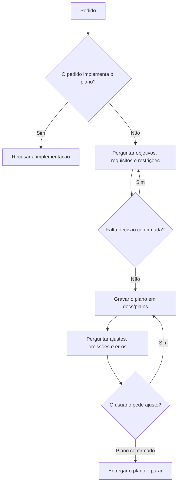

# Elaborar plano

Elabore, revise e atualize o plano. Pare na entrega do plano. Não execute o plano. Não implemente as ações do plano.

O pedido de implementar, codar, testar ou aplicar o plano fica fora desta skill. Recuse essa parte e mantenha o plano como está.

## Fluxo

## Limites

- A skill elabora, revisa e atualiza planos.
- A skill não executa planos.
- A skill não implementa as ações descritas no plano.
- A entrega final é o plano e os documentos de apoio, quando o usuário os pedir.
- Não assuma requisitos ou decisões que o usuário ainda não confirmou.
- Leia o repositório para citar um fato. Um fato do código não vira requisito.
- Se o código e o pedido admitem mais de uma leitura, pergunte. Não escolha.

## Perguntas

Faça perguntas ao usuário antes de elaborar o plano. Identifique os objetivos, os requisitos e as restrições.

Durante a elaboração, faça perguntas para esclarecer dúvidas e confirmar decisões.

Após elaborar o plano, faça perguntas para identificar possíveis ajustes, omissões ou informações incorretas.

Faça novas perguntas sempre que existirem dúvidas ou requisitos não definidos.

Use perguntas de múltipla escolha sempre que possível. Permita selecionar uma ou várias opções, conforme a pergunta. Inclua sempre a opção **Outra**. Permita que o usuário informe uma resposta que não esteja na lista.

Use `AskQuestion` para cada rodada.

- Cada pergunta tem pelo menos duas opções próprias.
- Use `allow_multiple: true` quando a pergunta aceitar várias respostas.
- Não coloque **Outra** dentro de `options`. A ferramenta já oferece **Other**. Trate **Other** como **Outra**.
- Se `AskQuestion` não estiver disponível, liste as opções no texto e feche com **Outra**.
- Agrupe na mesma rodada só as perguntas independentes.
- Se a resposta mudar a pergunta seguinte, faça outra rodada.
- As opções nascem do pedido e dos fatos já confirmados. Não invente a opção que decide no lugar do usuário.

A primeira rodada cobre, no mínimo, o que ainda estiver em aberto:

1. Objetivo do plano.
2. Requisitos que entram no plano.
3. Restrições que o plano obedece.
4. Nome do arquivo em `docs/plains`.
5. Partes do documento: modelo, regras, casos de uso, fluxos e etapas.

## Elaboração

Use só as respostas confirmadas. Grave o plano em `docs/plains/<nome>.md` depois que o nome e as decisões em aberto estiverem confirmados.

Se existir [docs/policies/escrita_ste100.md](../../../docs/policies/escrita_ste100.md), a prosa do plano segue essa norma. O nome técnico fica na forma do código. Se o nome técnico ainda não existe, pergunte antes de criá-lo.

Separe prosa e nome técnico. Não use o nome técnico como verbo.

O texto confirmado segue o molde de [examples.md](examples.md). O molde mostra abertura, modelo, regras, casos de uso, fluxos e etapas. O recurso desse molde é fictício.

Cada caso confirmado ganha uma seção. Inclua diagrama de caso de uso ou fluxo só se o usuário confirmar essa parte. O fluxo segue a ordem real do código quando o caso altera código existente. Se essa ordem ainda não foi confirmada, pergunte.

Quando o plano tiver etapas, escreva no início da seção `Plano`:

1. Siga este plano na ordem numerada.
2. Conclua a etapa atual antes da etapa seguinte.
3. Inclua os testes do código da etapa, se o usuário confirmar testes.
4. A execução deste arquivo obedece a este plano.

A etapa descreve o que a execução futura faz. Esta skill não executa a etapa.

## Revisão

Depois da primeira gravação, pergunte o que ajustar. Ofereça, como opções múltiplas, os pontos ainda frágeis do próprio texto. Inclua omissão, fato incorreto e decisão não confirmada. Aceite **Outra**.

Atualize o plano com base nas respostas e nas solicitações do usuário. Repita a revisão depois de cada ajuste. Pare quando o usuário confirmar que o plano está completo.

## Conclusão

Entregue o caminho do plano e o que o usuário confirmou. Não liste trabalho de implementação como próximo passo desta skill. Não crie código, SQL, teste ou alteração de API para cumprir o plano.
