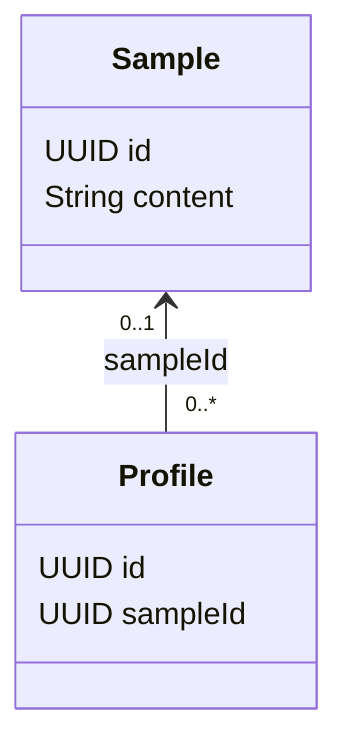
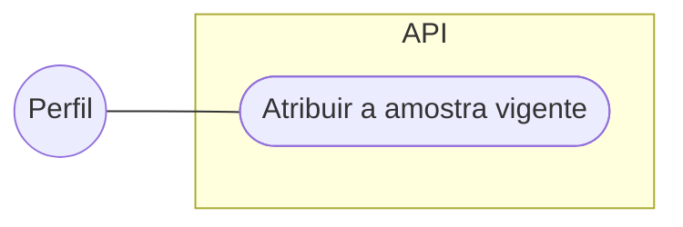
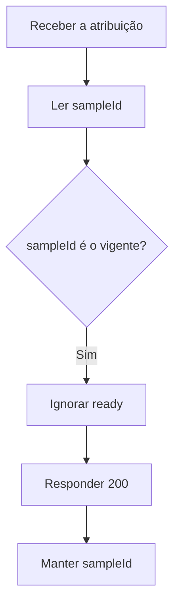
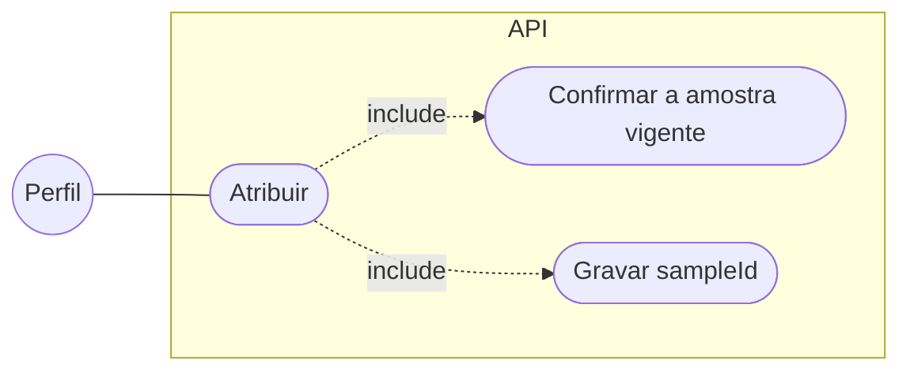
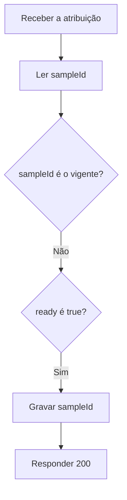
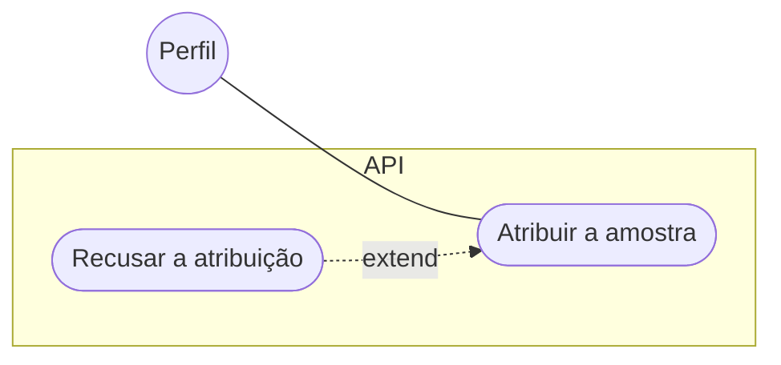
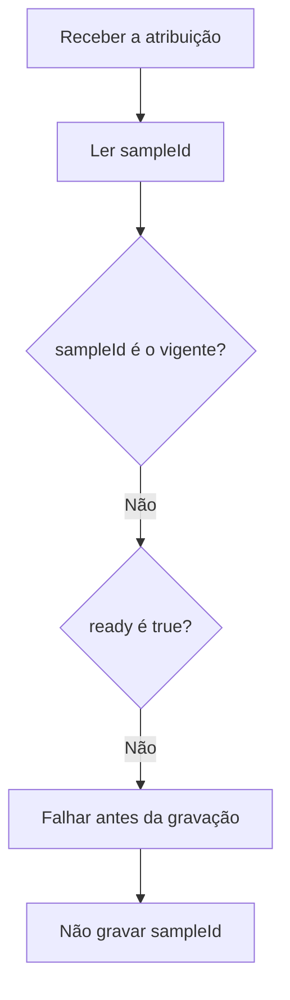
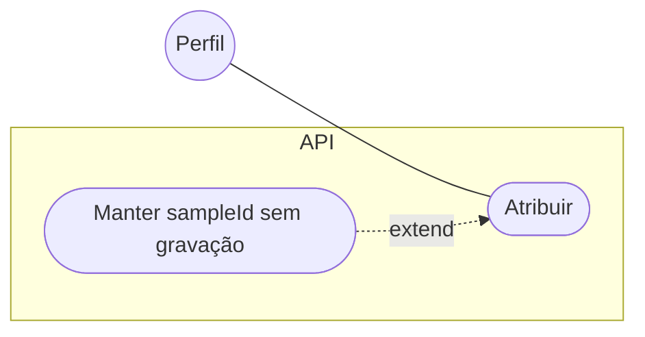
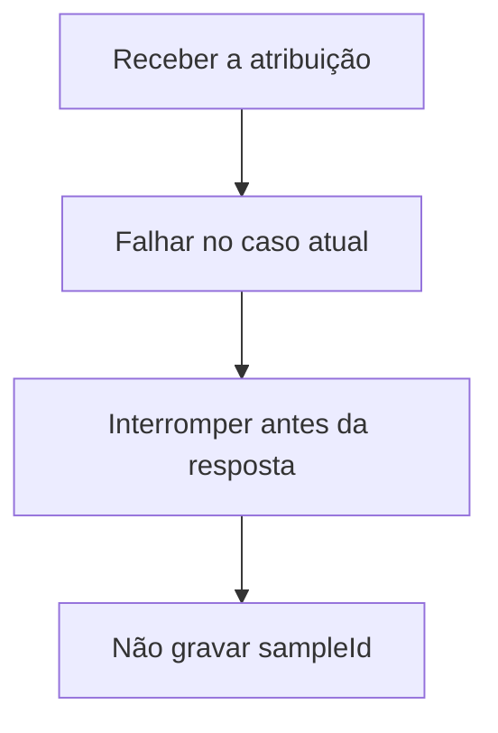

# Exemplo

Este arquivo é o molde genérico de um plano.
O recurso `Sample` é fictício.
A prosa segue a ASD-STE100 em português.
Cada seção entra quando o usuário a confirma.

Copie as seções, os diagramas e a prosa.
Troque o recurso pelos fatos confirmados.
Grave o plano em `docs/plains/<nome>.md`.

# Amostra

Há várias amostras ao mesmo tempo. O `id` de cada amostra é um UUIDv7. O maior `id` marca a amostra mais recente. Essa amostra é a vigente. O perfil guarda esse `id` em `sampleId`. Vários perfis apontam para a mesma amostra.

## Modelo

O diagrama liga uma `Sample` a muitos perfis. A `Sample` não carrega `profileId`. O `id` de `Sample` é a chave primária. A `Sample` guarda o texto em `content`. O perfil guarda a chave estrangeira em `sampleId`. A chave estrangeira fica ausente sem associação.

## Atribuição

O campo `ready` leva a atribuição do perfil. O valor `true` atribui a amostra vigente. A omissão e o valor `false` não atribuem. `AssignRequest` declara `ready`. Um campo extra nesse record é ignorado.

A atribuição lê `sampleId` antes da gravação. O perfil com `sampleId` vigente dispensa atribuição nova. O campo `ready` fica sem efeito nesse perfil. Essa atribuição segue sem gravação nova.

O perfil sem a amostra vigente envia `ready` com `true`. A atribuição grava `sampleId` só nesse perfil. A gravação troca o `id` em `sampleId`. Sem `true`, a atribuição falha antes da gravação.

Uma falha anterior deixa `sampleId` sem gravação. A resposta 200 exige o `id` da amostra vigente no perfil.

## Casos de uso

O ator de cada caso é o perfil. Cada caso cabe em um diagrama. O fluxo fecha o mesmo caso. A `Sample` não é ator. A rota da atribuição é `POST /samples/assign`.

### Atribuir a amostra vigente

O perfil já guarda o `sampleId` vigente. A atribuição responde 200. Este caso não grava `sampleId`.

#### Fluxo

### Atribuir a amostra nova

O perfil não tem a amostra vigente. O corpo traz `ready` com `true`. A resposta 200 grava `sampleId`.

#### Fluxo

### Recusar a atribuição

O perfil não tem a amostra vigente. `ready` não é `true`. A atribuição falha antes da gravação. Este caso não grava `sampleId`.

#### Fluxo

### Falhar a atribuição

Uma falha da atribuição ocorre antes da resposta. Este caso não grava `sampleId`. O corpo inválido entra neste caso. O perfil ausente entra neste caso.

#### Fluxo

## Plano

Siga este plano na ordem numerada. Conclua a etapa atual antes da etapa seguinte. Inclua os testes do código da etapa. A execução deste arquivo obedece a este plano.

### Etapa 1. Domínio

1. Crie o record `Sample` no molde de `Note`.
2. Gere o `id` com UUIDv7.
3. Grave `content` em `Sample`.
4. Deixe `Sample` sem `profileId`.
5. Grave `sampleId` em `Profile`.
6. Aceite `sampleId` nulo.

### Etapa 2. Porta

1. Crie `SampleRepository` no molde de `NoteRepository`.
2. Consulte a amostra de maior `id`.
3. Trate essa amostra como a vigente.

### Etapa 3. SQL

1. Crie a tabela de `Sample` no molde de `note`.
2. Grave a FK de `sample_id` em `columns.sql`.
3. Crie a coluna `sample_id` em `profile`.
4. Aponte `sample_id` para o `id` de `Sample`.
5. Siga `settlement/note.sql` na massa de `Sample`.
6. Deixe `sample_id` nulo na massa antiga.

### Etapa 4. Persistência

1. Crie o adapter de `Sample` no molde de `Note`.
2. Leia a amostra vigente pela porta.
3. Grave `sampleId` pelo adapter de `Profile`.

### Etapa 5. Pedido

1. Declare `ready` em `AssignRequest`.
2. Leve `ready` ao command.
3. Trate omissão e `false` como ausência de atribuição.
4. Ignore campo extra nesse record.

### Etapa 6. Atribuição

1. Leia `sampleId` depois do perfil encontrado.
2. Pule a gravação quando `sampleId` é a vigente.
3. Exija `ready` com `true` sem a amostra vigente.
4. Falhe antes da gravação sem `true`.
5. Grave `sampleId` na mesma transação.

### Etapa 7. Testes

1. Cubra cada caso de uso deste arquivo.
2. Cubra o domínio, a porta e o SQL.
3. Cubra a atribuição no IT HTTP.
4. Não exclua classe nova do JaCoCo.

### Etapa 8. Documentação

1. Atualize o documento de API da amostra.
2. Descreva a gravação de `sampleId`.
3. Mantenha o nome `Sample` no glossário.
