# Termo de aceite

Há vários termos de aceite ao mesmo tempo. O `id` de cada termo é um UUIDv7. O maior `id` marca o termo mais recente. Esse termo é o vigente. O perfil guarda esse `id` em `termId`. Vários perfis apontam para o mesmo termo.

## Modelo

O diagrama liga um `Term` a muitos perfis. O `Term` não carrega `profileId`. O `id` de `Term` é a chave primária. O `Term` guarda o texto em `content`. O perfil guarda a chave estrangeira em `termId`. A chave estrangeira fica ausente sem associação.

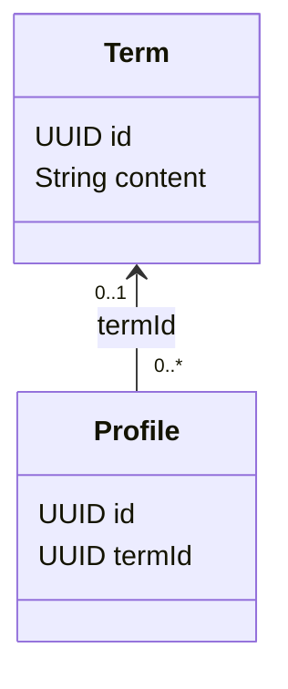

## Aprovação

O campo `termAccepted` leva a aprovação do perfil. O valor `true` aprova o termo vigente. A omissão e o valor `false` não aprovam. `SignInRequest` declara `termAccepted`. `RefreshRequest` declara `termAccepted`. Um campo extra nesses records é ignorado.

`SignInTokenUseCase` lê `termId` antes da aprovação. O perfil com `termId` vigente dispensa aprovação nova. O campo `termAccepted` fica sem efeito nesse perfil. Esse `signin` segue sem gravação nova. Esse `refresh` segue sem gravação nova. O retry dentro de `refresh-grace-seconds` segue a mesma regra.

O perfil sem o termo vigente envia `termAccepted` com `true`. O `signin` grava `termId` só nesse perfil. O `refresh` grava `termId` só nesse perfil. A gravação troca o `id` em `termId`. Sem `true`, o `signin` falha antes de `sessions.open`. Sem `true`, o `refresh` falha antes de devolver a sessão.

O corpo do `signin` traz e-mail e senha. O `signin` lê o perfil pelo e-mail. O primeiro acesso é o `signin` com resposta 200 que apaga `VERIFY_EMAIL`. O primeiro acesso sem termo vigente entra na aprovação. O `refresh` ativo lê o `profileId` na sessão do Redis. O retry lê o `profileId` pela sessão do `sessionId`.

O `code` de `VERIFY_EMAIL` permanece obrigatório no caso atual. O `code` de `SIGN_IN` permanece obrigatório no caso atual. A falha sem `true` não consome `VERIFY_EMAIL` nem `SIGN_IN`. O `signin` grava `termId` antes de `sessions.open`. Essa gravação fica na transação do `signin`. O `refresh` grava `termId` depois do par aceito.

Uma falha anterior deixa `termId` sem gravação. A resposta 200 do `signin` exige o `id` do termo vigente no perfil. A resposta 200 do `refresh` exige o `id` do termo vigente no perfil. `VERIFY_EMAIL` no `refresh` ativo responde 403. Essa resposta não grava `termId`.

## Casos de uso

O ator de cada caso é o perfil. Cada caso cabe em um diagrama. O fluxo fecha o mesmo caso. O `Term` não é ator. O `Term` não tem rota HTTP.

### Entrar com o termo vigente

O perfil já guarda o `termId` vigente. O `signin` responde 200. Este caso não grava `termId`.

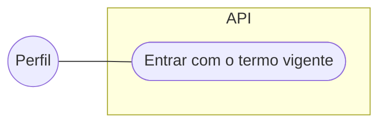

#### Fluxo

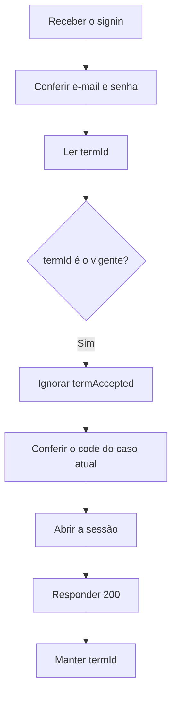

### Entrar aprovando o termo vigente

O perfil não tem o termo vigente. O corpo traz `termAccepted` com `true`. O `signin` com resposta 200 grava `termId`. O primeiro acesso entra neste caso.

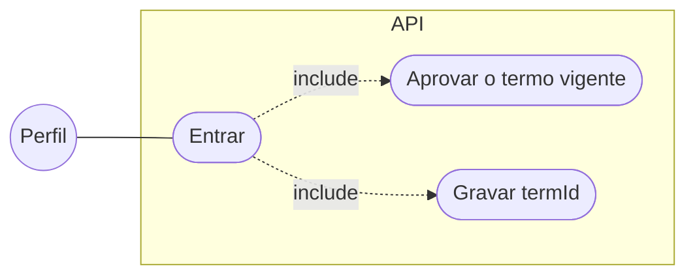

#### Fluxo

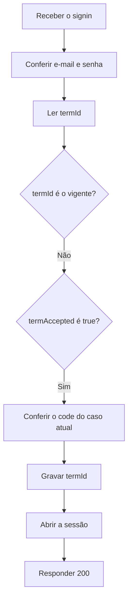

### Renovar com o termo vigente

O perfil já guarda o `termId` vigente. O `refresh` responde 200. O retry dentro de `refresh-grace-seconds` segue este caso. Este caso não grava `termId`.

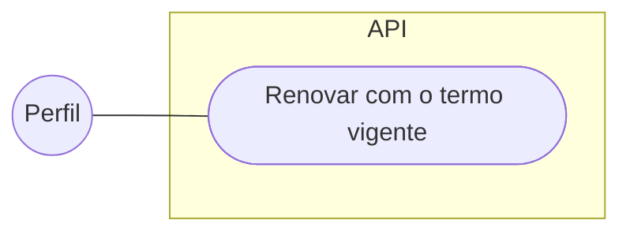

#### Fluxo

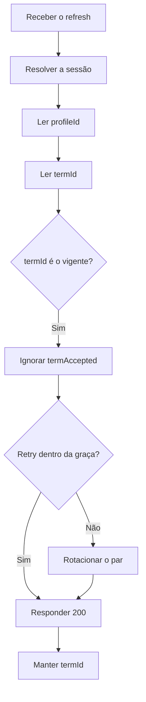

### Renovar aprovando o termo vigente

O perfil não tem o termo vigente. O corpo traz `termAccepted` com `true`. O retry dentro de `refresh-grace-seconds` exige `termAccepted`. A gravação ocorre depois do par aceito.

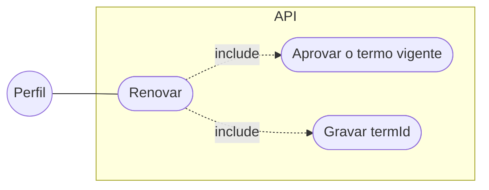

#### Fluxo

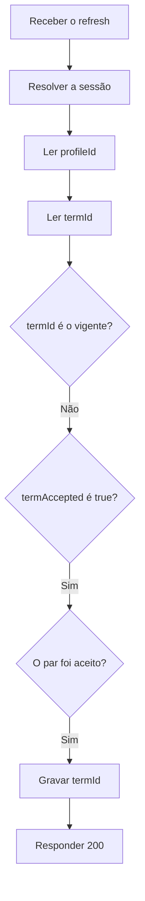

### Recusar o signin

O perfil não tem o termo vigente. `termAccepted` não é `true`. O `signin` falha antes de `sessions.open`. Este caso não grava `termId`.

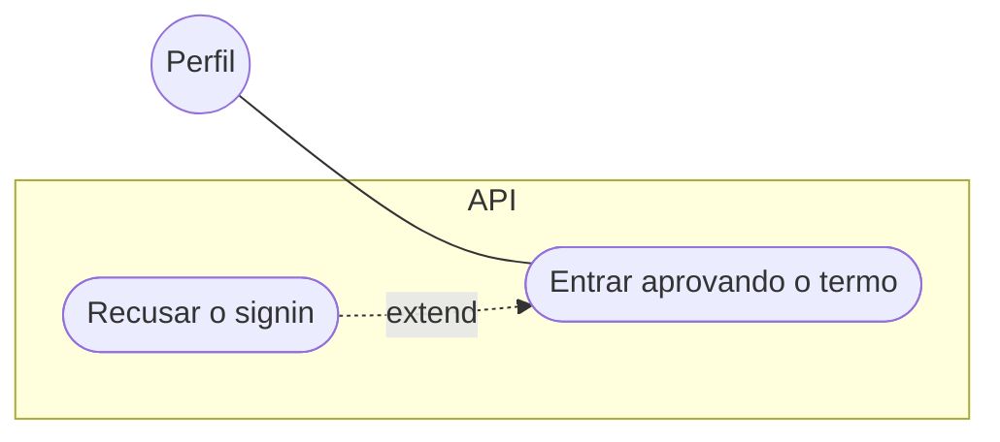

#### Fluxo

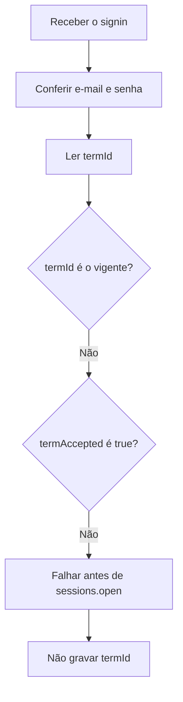

### Recusar o refresh

O perfil não tem o termo vigente. `termAccepted` não é `true`. O `refresh` falha antes de devolver a sessão. Este caso não grava `termId`.

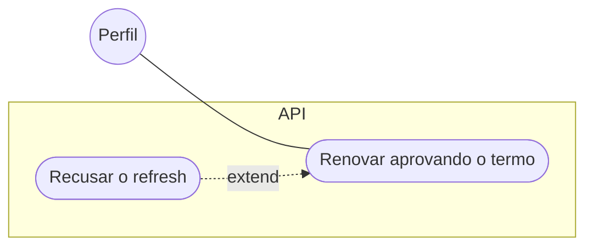

#### Fluxo

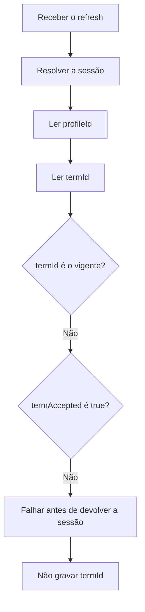

### Falhar o signin

Uma falha do `signin` ocorre antes da resposta. Este caso não grava `termId`. A credencial inválida entra neste caso. O `code` divergente entra neste caso. O limite de tentativas entra neste caso. O Redis indisponível entra neste caso.

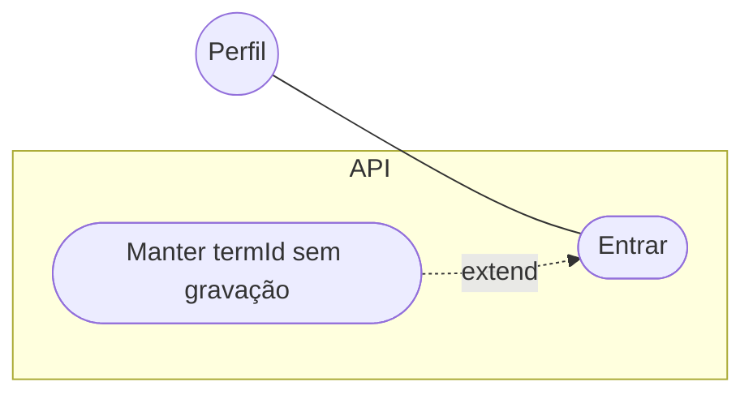

#### Fluxo

### Falhar o refresh

Uma falha do `refresh` ocorre antes da resposta. Este caso não grava `termId`. O refresh inválido entra neste caso. O limite de tentativas entra neste caso. `VERIFY_EMAIL` no refresh ativo entra neste caso.

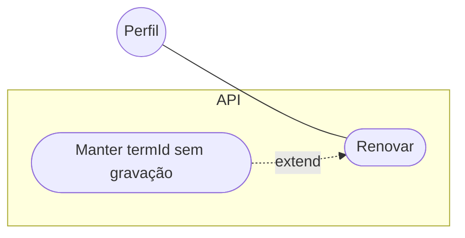

#### Fluxo

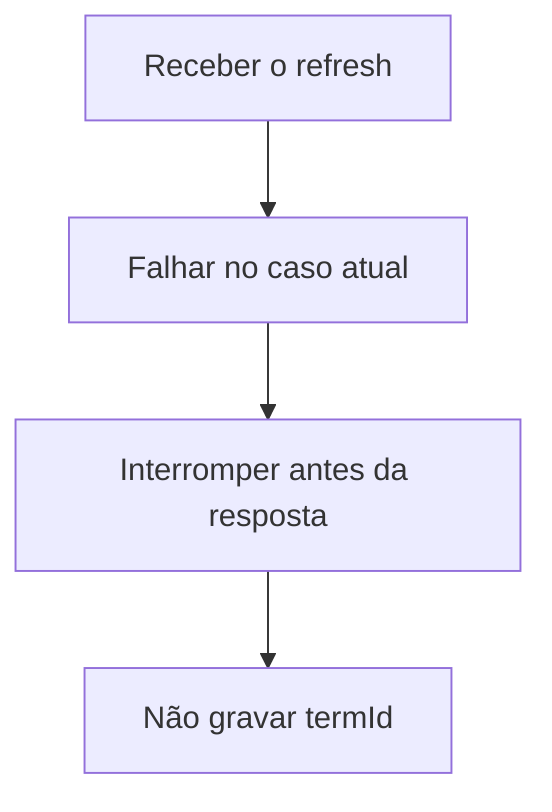

## Plano

Siga este plano na ordem numerada. Conclua a etapa atual antes da etapa seguinte. Inclua os testes do código da etapa. A execução deste arquivo obedece a este plano.

### Etapa 1. Domínio

1. Crie o record `Term` no molde de `Note`.
2. Gere o `id` com UUIDv7.
3. Grave `content` em `Term`.
4. Deixe `Term` sem `profileId`.
5. Grave `termId` em `Profile`.
6. Aceite `termId` nulo.

### Etapa 2. Porta

1. Crie `TermRepository` no molde de `NoteRepository`.
2. Consulte o termo de maior `id`.
3. Trate esse termo como o vigente.

### Etapa 3. SQL

1. Crie a tabela de `Term` no molde de `note`.
2. Grave a FK de `term_id` em `columns.sql`.
3. Crie a coluna `term_id` em `profile`.
4. Aponte `term_id` para o `id` de `Term`.
5. Siga `settlement/note.sql` na massa de `Term`.
6. Deixe `term_id` nulo na massa antiga.

### Etapa 4. Persistência

1. Crie o adapter de `Term` no molde de `Note`.
2. Leia o termo vigente pela porta.
3. Grave `termId` pelo adapter de `Profile`.

### Etapa 5. Pedido

1. Declare `termAccepted` em `SignInRequest`.
2. Declare `termAccepted` em `RefreshRequest`.
3. Leve `termAccepted` aos commands.
4. Trate omissão e `false` como ausência de aprovação.
5. Ignore campo extra nesses records.

### Etapa 6. Signin

1. Leia `termId` depois da senha conferida.
2. Mantenha o `code` dos casos atuais.
3. Pule a gravação quando `termId` é o vigente.
4. Exija `termAccepted` com `true` sem o termo vigente.
5. Falhe antes de `sessions.open` sem `true`.
6. Não consuma `VERIFY_EMAIL` nem `SIGN_IN` nessa falha.
7. Grave `termId` na transação, antes de `sessions.open`.

### Etapa 7. Refresh

1. Resolva a sessão antes de ler `termId`.
2. Leia o `profileId` também no retry da graça.
3. Pule a gravação quando `termId` é o vigente.
4. Exija `termAccepted` com `true` sem o termo vigente.
5. Falhe antes de devolver a sessão sem `true`.
6. Grave `termId` depois do par aceito.
7. Mantenha o 403 de `VERIFY_EMAIL` no refresh ativo.
8. Não grave `termId` nesse 403.

### Etapa 8. Testes

1. Cubra cada caso de uso deste arquivo.
2. Cubra o domínio, a porta e o SQL.
3. Cubra o `signin` e o `refresh` no IT HTTP.
4. Não exclua classe nova do JaCoCo.

### Etapa 9. Documentação

1. Atualize `docs/api/tokens.md` com `termAccepted`.
2. Descreva a gravação de `termId` no `signin`.
3. Descreva a gravação de `termId` no `refresh`.
4. Mantenha `Term` sem rota HTTP.
5. Mantenha o nome `Term` no glossário.
